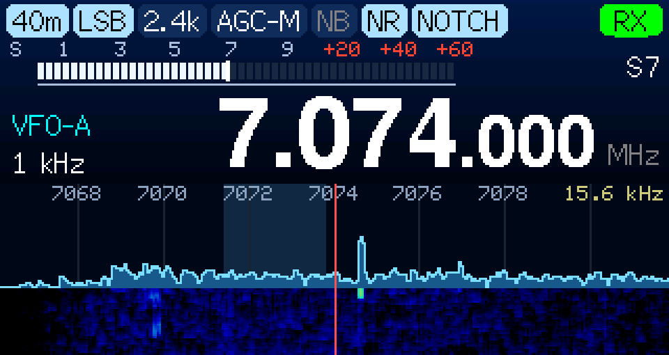
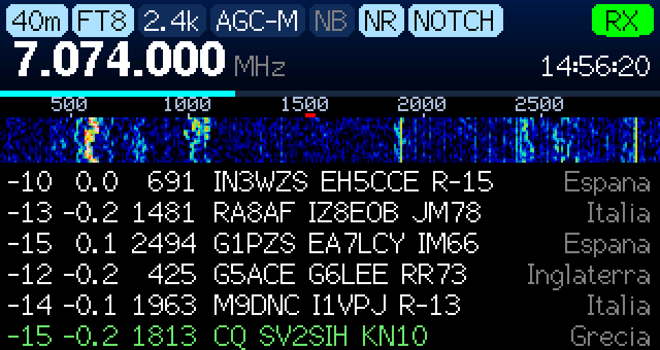
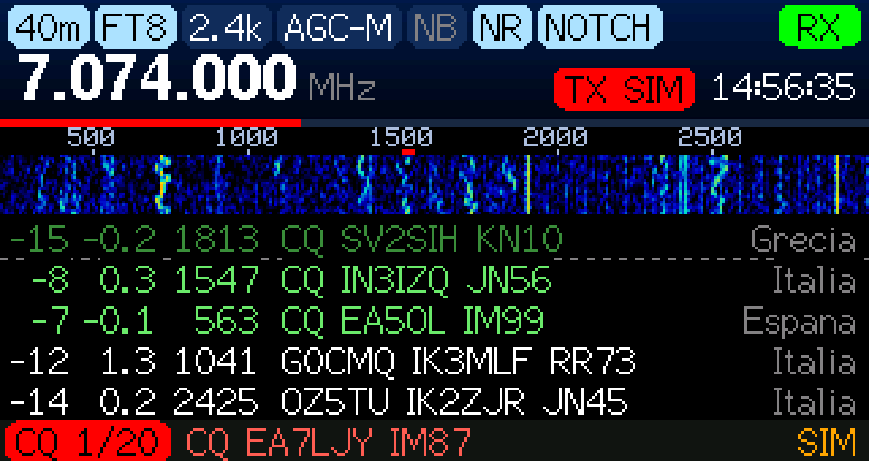
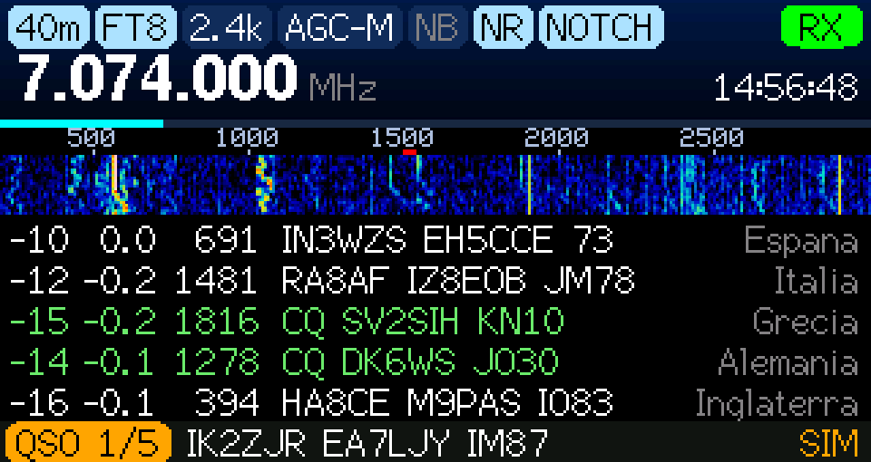
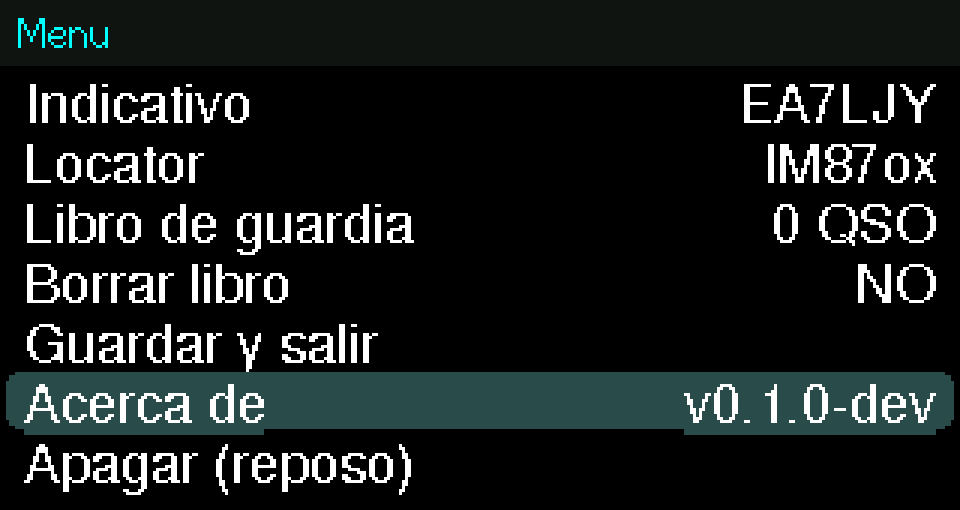
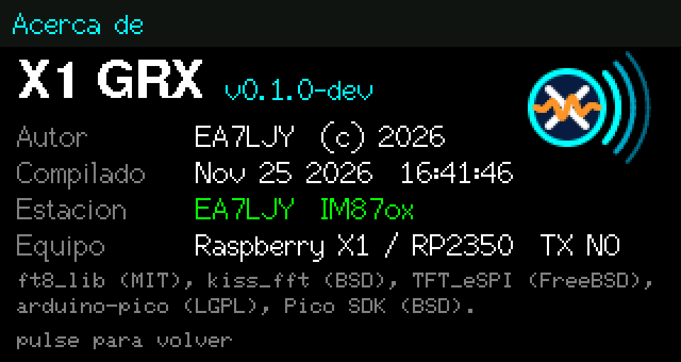
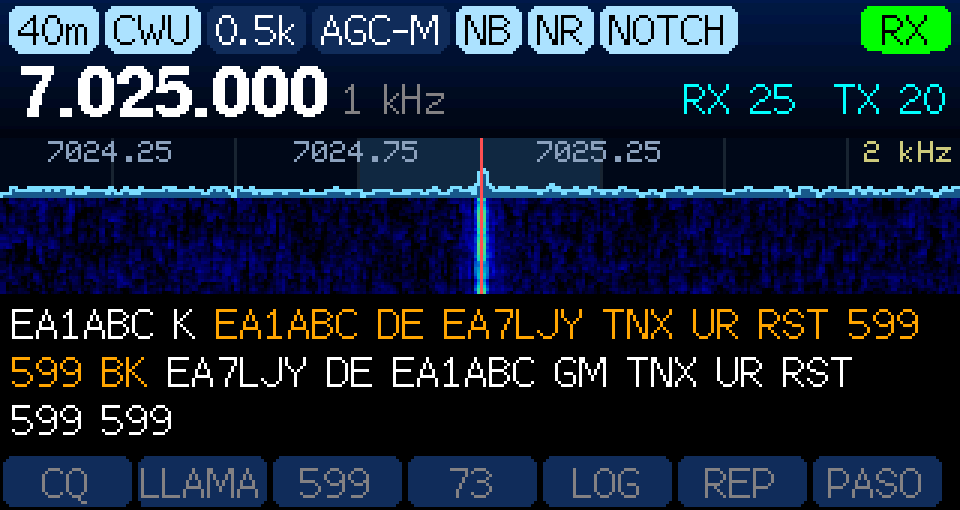
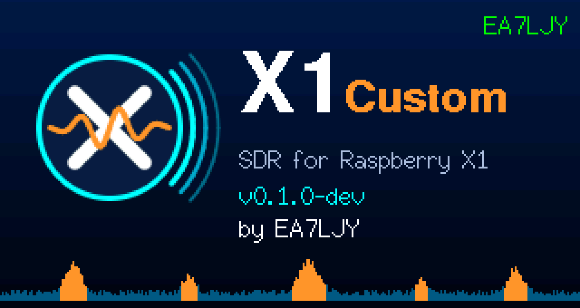
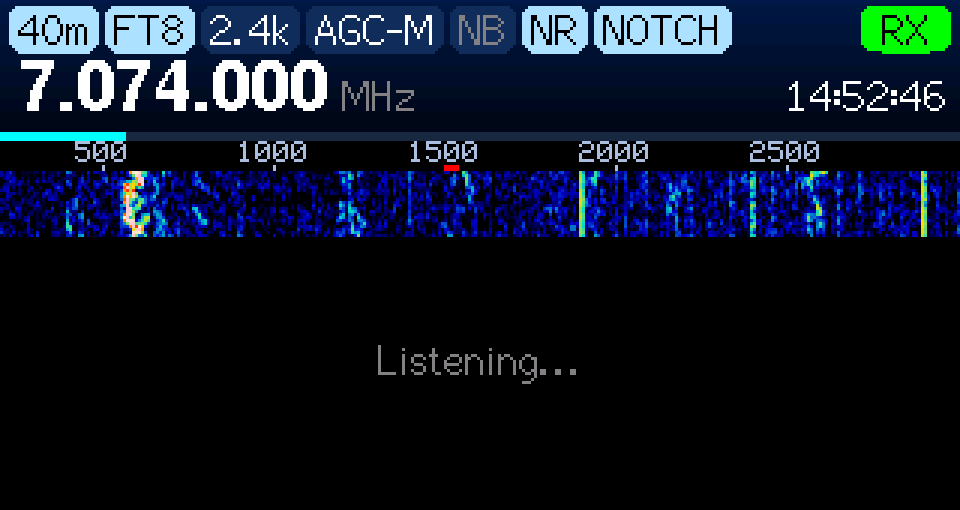
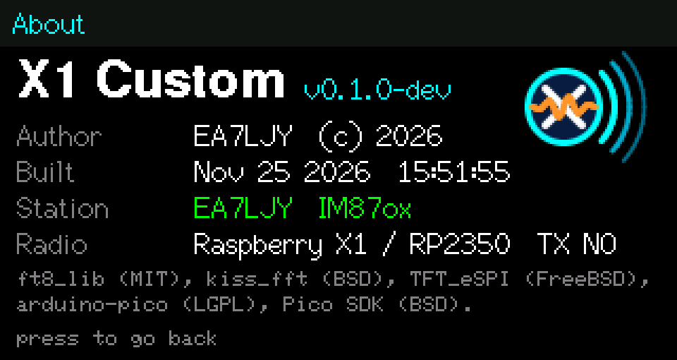

# X1 GRX — firmware para la Raspberry X1

**Español** · [English](#english)

Firmware alternativo para el receptor SDR de HF **HamGeek Raspberry X1** (80–10 m, RP2350), y una
guía para añadirle la etapa de transmisión.

**Autor:** EA7LJY — [@ea7ljy73](https://github.com/ea7ljy73)

  

---

## Capturas

Son capturas reales de la pantalla de 320×170 del equipo, ampliadas ×3.

| | |
| --- | --- |
|  |  |
| **Pantalla principal:** S-meter, frecuencia, espectro y cascada con zoom | **FT8:** decodificación continua, con el país de cada estación |
|  |  |
| **CQ automático:** llama y contesta solo | **QSO automático:** eliges una estación y el intercambio se completa solo |
|  |  |
| **Menú** en español o inglés | **Acerca de:** versión y datos de la estación |
|  | |
| **QSO en CW:** decodificación en pantalla (blanco, lo recibido; naranja, lo enviado) y macros CQ / LLAMA / 599 / 73 / LOG | |

## Funciones

- **Modos:** LSB, USB, CW, AM, FM, digital (DGL/DGU) y FT8.
- **Espectro y cascada:** ancho de 15,6 a 1 kHz, siempre centrados en el dial.
- **Procesado de audio:** AGC de tres velocidades, supresor de ruido (NB), reductor de ruido (NR)
  y notch automático.
- **CW:** decodificador en pantalla y pantalla propia para hacer QSO: la conversación (lo recibido
  y lo enviado), macros CQ / llamada / 599 / 73 con los indicativos ya puestos y anotación en el
  libro. **Entrenador de CW:** ejercicios para copiar de oído (letras, mixto, indicativos, palabras
  de QSO) y práctica de manipulación con las palas, con la velocidad medida. Sin transmitir.
- **FT8:** monitor con hora UTC y país de cada estación. El QSO puede ser automático (CQ o
  respuesta a una estación) o manual.
- **Libro de guardia** en la propia radio, exportable en formato ADIF por USB.
- **Estación:** indicativo y locator editables desde el menú.
- **Idioma:** pantallas en español o inglés.
- **TX preparado** para cuando se monte la etapa de transmisión: secuenciador, corte por ROE y
  tiempo máximo. Sin la etapa instalada, el firmware nunca transmite y el QSO de FT8 se muestra
  simulado.

## Instalación

1. Descarga el último `X1-GRX-<versión>.uf2` de la carpeta [`firmware/`](firmware/).
2. Con la radio apagada, mantén pulsado el botón **BOOTSEL** de la Pico y conéctala al PC por USB.
   Aparece una unidad llamada `RP2350`.
3. Copia el `.uf2` en esa unidad. La radio se reinicia sola con el nuevo firmware.

Para volver al firmware de fábrica, repite los pasos con el `.uf2` original del fabricante.

La versión actual (0.1.0-dev) está en pruebas; cuando se publique, aparecerá en
[`firmware/`](firmware/).

## Manual de uso

El [**manual de uso**](docs/MANUAL.md) explica los mandos, el menú, la pantalla de QSO en CW, el
entrenador de CW, FT8 y el libro de guardia.

## Modificación TX

En [`hardware/`](hardware/) tienes:
- la guía para montar la etapa de potencia, los filtros paso bajo, el acoplador de ROE y los relés;
- la lista de compra.

## Licencia

- **Firmware X1 GRX (binario):** © 2026 EA7LJY, todos los derechos reservados. Puedes usarlo y
  copiarlo gratis, sin modificarlo ni venderlo.
- **Componentes de terceros:** el binario incluye ft8_lib (MIT), kiss_fft (BSD), TFT_eSPI, el core
  arduino-pico (LGPL-2.1) y el Pico SDK (BSD-3-Clause). Sus licencias se entregan con cada versión.
- **Documentación de hardware:** véase [`LICENSE`](LICENSE).

## ⚠️ Aviso

Proyecto independiente: **no está afiliado** a HamGeek, al diseñador de la Raspberry X1 ni a
Raspberry Pi Ltd. Las marcas pertenecen a sus titulares.

El firmware y la documentación se ofrecen **«tal cual»**, sin garantía. **El autor no se hace
responsable de ningún daño** al equipo, a la antena, a otros equipos o a personas.

**Transmitir requiere licencia de radioaficionado.** Para hacer pruebas, usa carga fantasma y
vatímetro.

---

# X1 GRX — firmware for the Raspberry X1

[Español](#es) · **English**

Alternative firmware for the **HamGeek Raspberry X1** HF SDR receiver (80–10 m, RP2350), and a guide
to adding the transmit stage.

**Author:** EA7LJY — [@ea7ljy73](https://github.com/ea7ljy73)

  

## Screenshots

These are real captures of the radio's 320×170 display, scaled ×3.

| | |
| --- | --- |
|  |  |
| **FT8:** continuous decoding with each station's country | **About:** version and station data |
|  | |
| **CW QSO:** on-screen decoding (white received, orange sent) and CQ / call / 599 / 73 / log macros | |

See the [Spanish section](#es) for more screenshots. The whole interface is available in English:
**Menu → Idioma / Language**.

## Features

- **Modes:** LSB, USB, CW, AM, FM, digital (DGL/DGU) and FT8.
- **Spectrum and waterfall:** span from 15.6 down to 1 kHz, always centred on the dial.
- **Audio processing:** three-speed AGC, noise blanker (NB), noise reduction (NR) and auto notch.
- **CW:** on-screen decoder and a QSO screen of its own: the conversation (received and sent),
  CQ / call / 599 / 73 macros with the callsigns filled in, and logging. **CW trainer:** drills to
  copy by ear (letters, mixed, callsigns, QSO words) and paddle practice with the measured speed.
  Nothing is transmitted.
- **FT8:** monitor with UTC time and each station's country. QSOs can be automatic (calling CQ or
  answering a station) or manual.
- **Logbook** stored in the radio, exported as ADIF over USB.
- **Station:** callsign and locator, editable from the menu.
- **Language:** screens in Spanish or English.
- **TX ready** for when the transmit stage is fitted: sequencer, SWR cut-off and time limit. Without
  the stage installed the firmware never transmits, and FT8 QSOs are shown as simulated.

## Installation

1. Download the latest `X1-GRX-<version>.uf2` from the [`firmware/`](firmware/) folder.
2. With the radio off, hold the Pico's **BOOTSEL** button and connect it to the PC over USB. A drive
   named `RP2350` appears.
3. Copy the `.uf2` onto that drive. The radio restarts on its own with the new firmware.

To go back to the factory firmware, repeat the steps with the manufacturer's original `.uf2`.

The current version (0.1.0-dev) is being tested; once released it will appear in
[`firmware/`](firmware/).

## User manual

The [**user manual**](docs/MANUAL.md#english) covers the controls, the menu, the CW QSO screen, the
CW trainer, FT8 and the logbook.

## TX modification

[`hardware/`](hardware/) contains:
- the guide to building the power stage, the low-pass filters, the SWR bridge and the relays;
- the shopping list.

## Licence

- **X1 GRX firmware (binary):** © 2026 EA7LJY, all rights reserved. You may use and copy it free
  of charge; you may not modify or sell it.
- **Third-party components:** the binary includes ft8_lib (MIT), kiss_fft (BSD), TFT_eSPI, the
  arduino-pico core (LGPL-2.1) and the Pico SDK (BSD-3-Clause). Their licences ship with every
  release.
- **Hardware documentation:** see [`LICENSE`](LICENSE).

## ⚠️ Disclaimer

This is an independent project: it is **not affiliated** with HamGeek, the Raspberry X1 designer or
Raspberry Pi Ltd. Trademarks belong to their owners.

The firmware and the documentation are provided **"as is"**, without warranty. **The author is not
liable for any damage** to the radio, the antenna, other equipment or people.

**Transmitting requires an amateur radio licence.** Use a dummy load and a power meter for testing.
