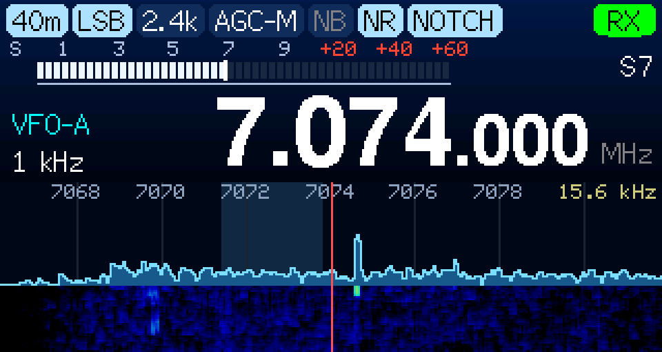
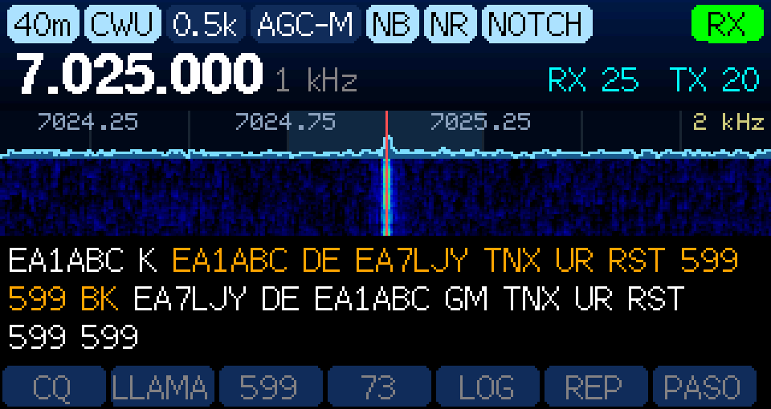
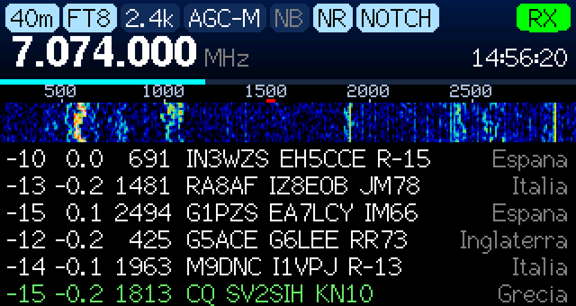

# Manual de uso de X1 GRX

**Español** · [English](#english)

Firmware X1 GRX 0.1.0-dev para la HamGeek Raspberry X1. Esta versión es **solo de recepción**: la
transmisión está bloqueada mientras no se active «Etapa TX instalada» en el menú. Sin la etapa, los
envíos de CW y los QSO de FT8 se muestran simulados («TX SIM») y nunca se transmite.

## 1. Instalación

1. Con la radio desconectada, mantén pulsado el botón **BOOTSEL** de la Pico 2 y conecta el USB al
   ordenador. Aparece una unidad llamada `RP2350`.
   - Si ya tienes X1 GRX instalado, no hace falta abrir la caja: envía la letra `B` por el puerto
     serie (en Linux, `echo B > /dev/ttyACM0`; en Windows, con el «Monitor serie» del Arduino IDE).
2. Copia el fichero `.uf2` a esa unidad. La radio se reinicia sola.
3. La primera vez aparece «Config. por defecto»: es normal.

Para volver al firmware de fábrica, repite los pasos con los ficheros originales del fabricante
(primero `EEPROM_CLEAR_BOOT`, luego el firmware).

## 2. Mandos

Todo se maneja con el mando:

| Acción | Efecto general |
| --- | --- |
| **Girar** | sintoniza, o cambia lo que esté seleccionado |
| **Pulsar** | cambia el paso de sintonía, o acepta |
| **Mantener pulsado** | abre el menú, o sale |

Los ajustes se guardan solos a los 3 s de dejar de tocarlos.

## 3. Pantalla principal

- **Arriba:** banda, modo, filtro, AGC y los indicadores NB / NR / NOTCH; a la derecha, RX o TX.
- **Frecuencia** y paso de sintonía; S-meter.
- **Espectro y cascada**, siempre centrados en el dial; el ancho se cambia en «Ancho espectro».

Girar sintoniza; pulsar cambia el paso (10 Hz … 100 kHz); mantener abre el menú.

## 4. Menú

Gira para recorrerlo, pulsa para editar una opción (girar cambia el valor, pulsar vuelve al menú) y
mantén pulsado para salir.

| Opción | Qué hace |
| --- | --- |
| Banda | 160 a 10 m, 11 m (solo RX) y SWL |
| Modo | LSB, USB, CWL, CWU, AM, FM, DGL, DGU, FT8 |
| Paso | paso de sintonía |
| Ancho espectro | zoom del espectro: 15,6 kHz a 1 kHz |
| Volumen | volumen de audio |
| Filtro RX | ancho del filtro de recepción |
| AGC | OFF, lento, medio, rápido |
| Supresor de ruido (NB) | quita impulsos (chispas, motores); 0 = apagado, 1 a 10 |
| Reductor de ruido (NR) | reduce el soplido de fondo; 0 = apagado, 1 a 10 |
| Notch automático | elimina portadoras fijas (pitidos) |
| Decodificador CW | activa la pantalla de QSO en CW (modo CWU/CWL) |
| Entrenador CW | ejercicios de escucha y de manipulación |
| AGC: margen sobre ruido | cuánto sube el AGC sobre el ruido de la banda |
| Manipulador / Velocidad CW / Retardo CW | yámbico B, yámbico A o recto; WPM; break-in |
| Etapa TX instalada | desbloquea la transmisión (solo con la etapa montada) |
| Invertir pantalla, Idioma / Language | aspecto e idioma (español o inglés) |
| QSO FT8, Anotar QSO FT8, Frec. TX FT8 | automático o manual; preguntar o anotar solo; frecuencia de audio |
| Indicativo, Locator | tus datos (necesarios para los macros y el libro) |
| Libro de guardia, Borrar libro | número de QSO anotados; borrado |
| Guardar y salir, Acerca de, Apagar | |

Las opciones «Servicio» y «Calibrar» son para ajustar el hardware; no hace falta tocarlas.

**Indicativo y Locator:** girar cambia la letra, pulsar pasa a la siguiente y mantener guarda (vacío =
borrar).

## 5. CW

### Pantalla de QSO en CW

Con **Menú → Decodificador CW** activado y el modo en CWU o CWL, la radio muestra la pantalla de CW:

- **Cabecera:** frecuencia, paso y velocidades: **RX** (la medida de la estación que oyes) y **TX** (la
  tuya). Mientras envías aparece «TX» o «TX SIM».
- **Espectro y cascada** de 2 kHz, con la línea roja en la frecuencia del tono.
- **Conversación:** en blanco lo recibido, en naranja lo enviado.
- **Botones:** CQ / LLAMA / 599 / 73 / LOG / REP / PASO.

| Acción | Efecto |
| --- | --- |
| Girar | sintoniza (o, con la barra activa, elige botón) |
| Pulsar | activa la barra de botones; con la barra activa, ejecuta el botón |
| Pulsar mientras se envía | para el envío |
| Mantener | sale de la barra; si no está activa, abre el menú |

- **CQ** llama; **LLAMA**, **599** y **73** ponen solos tu indicativo y el de la otra estación (el último
  indicativo decodificado).
- **LOG** abre la ficha para anotar el QSO en el libro.
- **REP** repite lo último enviado; **PASO** cambia el paso de sintonía.

Sintoniza la estación sobre la línea roja. El decodificador mide la velocidad solo (5 a 50 WPM) y no
escribe nada con ruido. Al encender espera unos 20 a 40 s a que la radio ajuste su corrección I/Q.

### Entrenador de CW

**Menú → Entrenador CW.** No transmite nunca.

- **Siguiente:** reproduce un ejercicio y, al terminar, muestra el texto para comprobar lo que has
  copiado. Pulsar mientras suena lo muestra directamente.
- **Tipo de ejercicio:** letras, mixto, indicativos o palabras de QSO.
- **WPM:** pulsa para editar la velocidad (5 a 50) y gira.
- **Palas:** practica manipulación. Se oye el tono local y la pantalla muestra lo que has enviado y tu
  velocidad.
- **Salir**, o mantener pulsado.

## 6. FT8

Elige el modo **FT8**. La pantalla muestra las estaciones decodificadas, con su hora UTC y su país.

- **Hora:** FT8 necesita la hora exacta. Envíala desde el ordenador al encender (en Linux,
  `echo "T$(date -u +%Y%m%d%H%M%S)" > /dev/ttyACM0`). Sin ella, la radio busca sola el periodo, pero
  el libro no lleva fecha.
- **Girar** elige una línea; **pulsar** contesta a esa estación (QSO automático) o, sin línea elegida,
  llama CQ. Pulsar durante un QSO lo para.
- En **QSO FT8 = Manual**, pulsar sobre una línea abre la ficha para anotarla en el libro.

## 7. Libro de guardia

Los QSO se guardan en la propia radio. **Menú → Libro de guardia** muestra cuántos hay. Para pasarlos
al ordenador, envía la letra `L` por el puerto serie: la radio responde con el libro en formato ADIF,
que puedes pegar en tu programa de log.

## 8. Problemas conocidos (0.1.0-dev)

- A veces, la primera respuesta que llega justo después de un envío propio en la pantalla de CW sale
  mal decodificada.
- Con mucho ruido aún puede colarse alguna ráfaga corta de letras.
- El audio de CW suena algo «ronco»; está pendiente de revisar.

---

# X1 GRX user manual

[Español](#es) · **English**

X1 GRX 0.1.0-dev firmware for the HamGeek Raspberry X1. This version is **receive only**: transmit
stays locked until "TX stage installed" is enabled in the menu. Without the stage, CW sending and FT8
QSOs are shown as simulated ("TX SIM") and nothing is ever transmitted.

## 1. Installation

1. With the radio unplugged, hold the Pico 2's **BOOTSEL** button and plug the USB cable into the PC.
   A drive named `RP2350` appears.
   - With X1 GRX already installed there is no need to open the case: send the letter `B` over the
     serial port (on Linux, `echo B > /dev/ttyACM0`; on Windows, with the Arduino IDE "Serial
     Monitor").
2. Copy the `.uf2` file onto that drive. The radio restarts on its own.
3. The first time it shows "Default settings": that is normal.

To go back to the factory firmware, repeat the steps with the manufacturer's original files
(`EEPROM_CLEAR_BOOT` first, then the firmware).

## 2. Controls

Everything is done with the knob:

| Action | General effect |
| --- | --- |
| **Turn** | tunes, or changes whatever is selected |
| **Press** | changes the tuning step, or accepts |
| **Hold** | opens the menu, or leaves |

Settings are saved on their own 3 s after the last change.

## 3. Main screen

- **Top:** band, mode, filter, AGC and the NB / NR / NOTCH indicators; RX or TX on the right.
- **Frequency** and tuning step; S-meter.
- **Spectrum and waterfall**, always centred on the dial; the width is set in "Spectrum span".

Turn to tune; press to change the step (10 Hz … 100 kHz); hold to open the menu.

## 4. Menu

Turn to move through it, press to edit an option (turn to change the value, press to go back to the
menu), and hold to leave.

| Option | What it does |
| --- | --- |
| Band | 160 to 10 m, 11 m (RX only) and SWL |
| Mode | LSB, USB, CWL, CWU, AM, FM, DGL, DGU, FT8 |
| Step | tuning step |
| Spectrum span | spectrum zoom: 15.6 kHz down to 1 kHz |
| Volume | audio volume |
| RX filter | receive filter width |
| AGC | OFF, slow, medium, fast |
| Noise blanker (NB) | removes impulses (sparks, motors); 0 = off, 1 to 10 |
| Noise reduction (NR) | lowers the background hiss; 0 = off, 1 to 10 |
| Auto notch | removes steady carriers (whistles) |
| CW decoder | turns on the CW QSO screen (CWU/CWL mode) |
| CW trainer | copying and keying drills |
| AGC: noise headroom | how far the AGC lifts the band noise |
| Keyer / CW speed / CW break-in delay | iambic B, iambic A or straight; WPM; break-in |
| TX stage installed | unlocks transmit (only with the stage fitted) |
| Invert display, Idioma / Language | look and language (Spanish or English) |
| FT8 QSO, Log FT8 QSO, FT8 TX freq. | automatic or manual; ask or log on its own; audio frequency |
| Callsign, Locator | your station data (needed for the macros and the logbook) |
| Logbook, Erase logbook | number of logged QSOs; erase |
| Save and exit, About, Power off | |

The "Service" and "Calibration" options are for setting up the hardware; there is no need to touch
them.

**Callsign and Locator:** turn to change the letter, press for the next one, hold to save (empty =
clear).

## 5. CW

### CW QSO screen

With **Menu → CW decoder** on and the mode set to CWU or CWL, the radio shows the CW screen (picture
in the Spanish section above):

- **Header:** frequency, step and speeds: **RX** (measured from the station you hear) and **TX**
  (yours). "TX" or "TX SIM" shows while sending.
- **Spectrum and waterfall**, 2 kHz wide, with the red line on the tone frequency.
- **Conversation:** received text in white, sent text in orange.
- **Buttons:** CQ / LLAMA (call) / 599 / 73 / LOG / REP (repeat) / PASO (step).

| Action | Effect |
| --- | --- |
| Turn | tunes (or, with the bar active, picks a button) |
| Press | activates the button bar; with the bar active, runs the button |
| Press while sending | stops sending |
| Hold | leaves the bar; if it is not active, opens the menu |

- **CQ** calls CQ; **LLAMA**, **599** and **73** fill in your callsign and the other station's (the
  last callsign decoded).
- **LOG** opens the logbook entry.
- **REP** repeats the last text sent; **PASO** changes the tuning step.

Tune the station onto the red line. The decoder measures the speed on its own (5 to 50 WPM) and writes
nothing on noise. After power-up it waits about 20 to 40 s while the radio settles its I/Q correction.

### CW trainer

**Menu → CW trainer.** It never transmits.

- **Next:** plays a drill and, when it ends, shows the text so you can check your copy. Pressing while
  it plays shows it straight away.
- **Drill type:** letters, mixed, callsigns or QSO words.
- **WPM:** press to edit the speed (5 to 50) and turn.
- **Paddles:** keying practice. You hear the local sidetone, and the screen shows what you sent and
  your speed.
- **Exit**, or hold the knob.

## 6. FT8

Select the **FT8** mode. The screen lists the decoded stations with their UTC time and country.

- **Time:** FT8 needs the exact time. Send it from the PC at power-up (on Linux,
  `echo "T$(date -u +%Y%m%d%H%M%S)" > /dev/ttyACM0`). Without it the radio finds the period on its
  own, but logbook entries have no date.
- **Turn** to pick a line; **press** to answer that station (automatic QSO) or, with no line picked,
  to call CQ. Pressing during a QSO stops it.
- With **FT8 QSO = Manual**, pressing on a line opens its logbook entry.

## 7. Logbook

QSOs are stored in the radio. **Menu → Logbook** shows how many there are. To copy them to a PC, send
the letter `L` over the serial port: the radio answers with the logbook in ADIF format, ready to paste
into your logging program.

## 8. Known issues (0.1.0-dev)

- The first reply that arrives right after your own CW sending is sometimes garbled.
- On a very noisy band a short burst of letters can still get through.
- CW audio sounds somewhat "hoarse"; still to be looked at.
